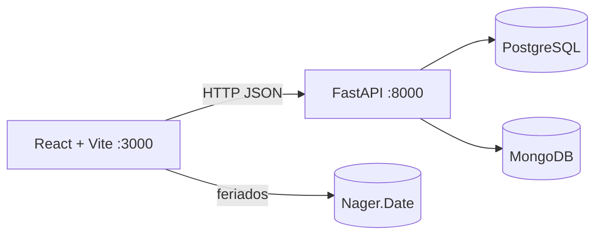
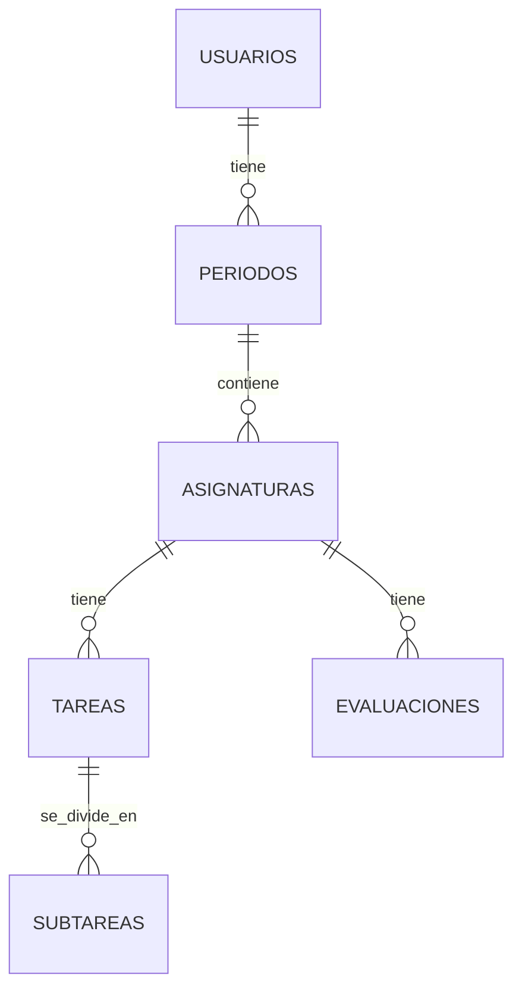

# Entregas · Agenda académica personal

Aplicación web para organizar asignaturas, evaluaciones, tareas y subtareas de un período académico, con avance, calendario, aviso de feriados e historial de cambios.

## 1. Proyecto e integrantes

**Entregas** · Maximiliano Valdés (trabajo individual)
Desarrollo web y móvil · UNAB · Taller N° 3 (caso 3.2, continuidad del Taller 2)

## 2. Problema y usuarios

Los estudiantes pierden el control de tareas, controles y proyectos de varias asignaturas: no saben qué vence primero ni cuánto llevan avanzado. **Entregas** lo concentra en un solo lugar.
**Usuarios:** estudiantes universitarios que cursan varias asignaturas por semestre.

## 3. Continuidad con el Taller 2

- **Se conserva:** páginas Panel, Actividades, Calendario y Asignaturas, filtros y alerta de feriados.
- **Cambia:** los datos ya no están en `localStorage`; React los pide a la API.
- **Se amplía:** períodos, evaluaciones con ponderación y nota, subtareas con fecha, reglas de negocio, historial en MongoDB y Docker Compose.

## 4. Arquitectura



- **Frontend** (`frontend/src`): `pages/`, `components/`, `services/`, `hooks/`.
- **Backend** (`backend/app`): `routers/`, `services/` (reglas e historial), `schemas.py`, `models.py`, `core/`.
- **Sin login:** la API usa un usuario demo fijo.

## 5. Tecnologías

React 18, Vite 5, Bootstrap 5 · Python 3.12, FastAPI, SQLAlchemy 2, Pydantic 2 · PostgreSQL 16 · MongoDB 7 · Docker Compose, nginx · pytest.

## 6. Modelo SQL y justificación de NoSQL



**PostgreSQL:** claves primarias y foráneas, email único, `fecha_fin > fecha_inicio`, código de asignatura único por período, ponderación entre 0 y 100. Borrar un período elimina en cascada lo que contiene.

**MongoDB** (`agenda_historial`): colecciones `actividad` y `eventos_planificacion`, usadas por la página **Historial**.
**Por qué documental:** son eventos que solo se agregan y cuyo detalle cambia según la acción. **Por qué no duplica SQL:** PostgreSQL guarda el estado actual; MongoDB guarda lo que ocurrió. Si Mongo falla, la operación principal sigue y el historial responde 503.

## 7. API y Swagger

Swagger: **http://localhost:8000/docs**

| Recurso | Endpoints |
|---|---|
| Períodos | `GET` `POST` `PUT` `DELETE` en `/periodos` |
| Asignaturas | `GET` `POST` `PATCH` `DELETE` en `/asignaturas` · `GET /asignaturas/{id}/avance` |
| Evaluaciones | `GET` `POST` `PATCH` `DELETE` en `/evaluaciones` |
| Tareas | `GET` `POST` `PATCH` `DELETE` en `/tareas` |
| Subtareas | `POST /tareas/{id}/subtareas` · `PATCH` y `DELETE /tareas/subtareas/{id}` |
| Historial | `GET /historial` · `GET /eventos-planificacion` |

**Reglas de negocio:** fecha dentro del período (400) · sin fechas pasadas en tareas y subtareas (400) · ponderaciones ≤ 100 % (400) · subtarea no vence después de su tarea (400) · no se completa una tarea con subtareas pendientes (409) · código de asignatura único por período (409).

**Códigos:** `200/201/204` éxito · `400` regla de negocio · `404` no encontrado · `409` conflicto · `422` formato inválido · `500` error genérico sin detalles internos · `503` historial no disponible.

## 8. API pública: Nager.Date

- Endpoint: `GET https://date.nager.at/api/v3/PublicHolidays/{año}/CL` (documentación: https://nagerholidays.com/api)
- Datos usados: `date` y `localName`, para alertar entregas en feriado (Panel) y marcar días (Calendario).
- Se integra **desde el frontend**: es un dato público, sin clave, que el backend no necesita.
- Si falla, se muestra un aviso y el resto de la app sigue funcionando.

## 9. Ejecución con Docker Compose

Requisito: Docker Desktop abierto.

```bash
git clone https://github.com/valdesmaximiliano77-beep/Proyecto-desarrollo-web-taller-3.git
cd Proyecto-desarrollo-web-taller-3
cp .env.example .env        # en PowerShell: Copy-Item .env.example .env
docker compose up --build
```

| Servicio | Puerto | Acceso |
|---|---|---|
| frontend | 3000 | http://localhost:3000 |
| api | 8000 | http://localhost:8000/docs |
| postgres | 5432 | base relacional |
| mongo | 27017 | historial |

La API crea las tablas y carga datos de prueba al iniciar. `docker compose down -v` borra también los datos.

## 10. Variables de entorno

Solo se suben los `.env.example`.
- **`/.env`**: `POSTGRES_USER`, `POSTGRES_PASSWORD`, `POSTGRES_DB`, `VITE_API_URL`.
- **`/backend/.env`** (API sin Docker): `DATABASE_URL`, `MONGO_URL`, `MONGO_DB`, `CORS_ORIGINS`.
- **`/frontend/.env`**: `VITE_API_URL`.

## 11. Pruebas y limitaciones

```bash
cd backend
pytest -q
```

Las pruebas usan SQLite en memoria y simulan MongoDB; la integración real se verifica en Swagger y con Docker.

**Limitaciones:** sin autenticación · sin migraciones (se usa `create_all`) · los períodos pueden solaparse · la interfaz no edita períodos ni asignaturas (la API sí).

## 12. Uso de Inteligencia Artificial

**Herramienta:** Claude (Anthropic). La usé como apoyo para diseñar el modelo, entender conceptos, corregir errores y adelantar tareas repetitivas. Probé, revisé y adapté todo lo que integré.

| Propósito | Prompt | Resultado | Validación humana | Aprendizaje |
|---|---|---|---|---|
| Modelo relacional en PostgreSQL | «Ayúdame a definir las tablas de períodos, asignaturas, evaluaciones, tareas y subtareas con sus claves y restricciones.» | Propuesta de tablas, relaciones 1 a N, claves foráneas y restricciones (email único, ponderación 0–100, código único por período). | Revisé que respetara mi caso del Taller 2, lo implementé en `models.py` y lo probé con `seed.py` y pytest. | Cómo se modelan relaciones 1 a N, qué hace una restricción y por qué la cascada borra lo dependiente. |
| Entender MongoDB | «No entiendo MongoDB: ¿qué es una colección y un documento, y cómo lo uso desde Python para un historial?» | Explicación de colecciones, documentos y PyMongo, con ejemplos de `actividad` y `eventos_planificacion`. | Lo integré en `services/historial.py` y comprobé en la página Historial que los eventos se guardan. | Cuándo conviene un modelo documental y por qué no duplica SQL. |
| Corregir error al eliminar subtareas | «Al pulsar Quitar en una subtarea no se elimina y Swagger responde error. ¿Qué falla?» | Detectó que faltaba el endpoint `DELETE /tareas/subtareas/{id}` y propuso agregarlo con su registro en el historial. | Probé el botón Quitar en la aplicación, en Swagger y ejecuté `pytest`. | Cómo el frontend y el backend deben coincidir en rutas y por qué un 404/405 apunta a una ruta inexistente. |
| Tareas repetitivas | «Genera los Dockerfile, el `docker-compose.yml`, datos de prueba y pruebas básicas para este proyecto.» | Borradores de configuración Docker, `seed.py` y `tests/test_api.py`. | Los ejecuté, corregí lo que falló y verifiqué que todo levantara con `docker compose up --build`. | Qué hace cada servicio, por qué la API usa el host `postgres` y no `localhost`. |
| Documentación y defensa | «Ayúdame con un borrador del README y un guion para la demo.» | Borrador de README, guion y preguntas probables. | Lo reduje y adapté a mi proyecto. | Cómo documentar arquitectura, modelo y limitaciones. |
