# Memoria de integración: React → Android con Capacitor

**Proyecto:** Entregas · Agenda académica personal
**Integrante:** Maximiliano Valdés
**Asignatura:** Desarrollo Web y Móvil (PTEC103)

## 1. Diagnóstico

| Punto | Resultado |
|---|---|
| Tipo de proyecto | React 18 + Vite 5 (SPA estática, salida en `dist/`), compatible con toda la guía |
| Rutas | `HashRouter`; se conservó sin cambios |
| Backend | FastAPI en `:8000`, PostgreSQL y MongoDB con Docker Compose |
| Build web inicial | `npm run build` correcto antes de modificar nada |
| Entorno | Node 26, JDK 21, Android Studio 2026.2, emulador con Android 17 (API 37) |
| Respaldo | Commit `3cf9441` (árbol limpio antes de empezar) |

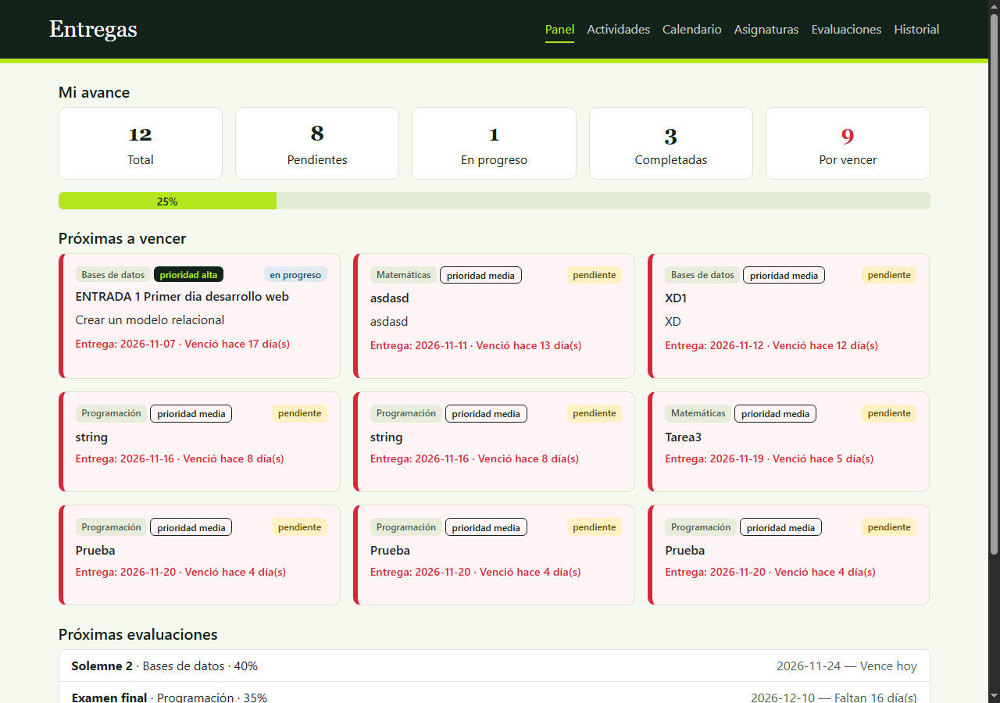

## 2. Adaptación móvil

Se midió cada página en Chrome emulando 360 px de ancho, antes y después:

| Página | Controles de menos de 44 px (antes → después) | Elementos fuera de pantalla (antes → después) |
|---|---|---|
| Panel | 6 → 0 | 0 → 0 |
| Actividades | 63 → 0 | 0 → 0 |
| Calendario | 9 → 0 | 0 → 0 |
| Asignaturas | 19 → 0 | 0 → 0 |
| Evaluaciones | 17 → 0 | 21 → 0 |
| Historial | 9 → 0 | 111 → 0 |

A 390 px y dentro de la app en el emulador (411 px) tampoco quedaron controles pequeños ni desbordes.

Cambios, en `src/styles/estilos.css` salvo que se indique:

- **Menú:** cuadrícula de 3 columnas con zonas de toque completas.
- **Tablas** de Evaluaciones e Historial: en el teléfono cada fila es una tarjeta.
- **Formularios:** etiquetas visibles. Los campos de fecha vacíos se ven en blanco en Android, así que sin etiqueta no se sabía qué eran. Teclado decimal en la ponderación.
- **Avisos:** flotan abajo. Antes, al fallar algo en una tarjeta del final de la lista, el mensaje aparecía arriba, fuera de la vista.
- **Borde a borde:** `viewport-fit=cover` y márgenes seguros para no quedar bajo las barras del sistema.
- **Botón Atrás** (`src/services/botonAtras.js`): vuelve a la página anterior; en la primera, minimiza la app.

| Antes (360 px) | Después (360 px) |
|---|---|
| 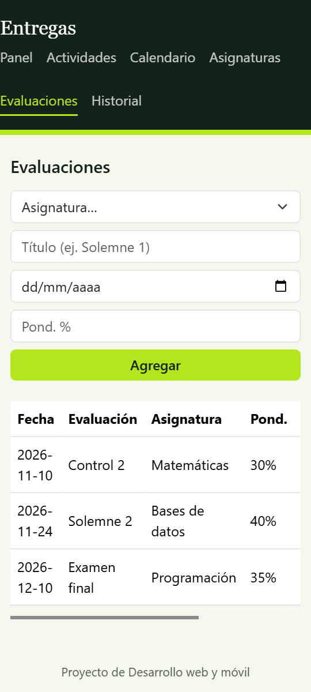 | 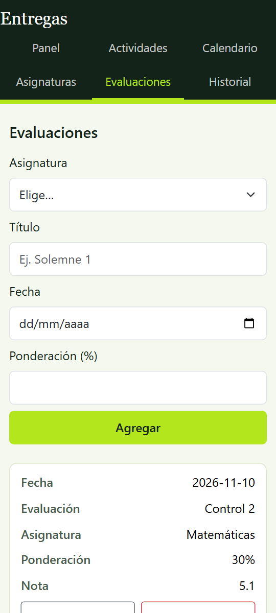 |

## 3. Integración de Capacitor 8

```bash
npm install @capacitor/core@8 @capacitor/android@8 @capacitor/app@8 @capacitor/local-notifications@8
npm install -D @capacitor/cli@8
npx cap init "Entregas" cl.unab.entregas --web-dir dist
npm run build
npx cap add android
npx cap sync android
```

`npx cap doctor` responde «Android looking great!». La configuración está en `capacitor.config.json`; no se usa `server.url`, así que la interfaz se carga desde los archivos compilados.

## 4. Conexión con la API

| Dónde corre React | URL de la API | Variable |
|---|---|---|
| Navegador del PC | `http://localhost:8000` | `VITE_API_URL` |
| Emulador Android | `http://10.0.2.2:8000` | `VITE_API_ANDROID` |
| Teléfono en la misma red | `http://IP_DEL_PC:8000` | `VITE_API_ANDROID` (recompilar) |

`src/services/api.js` elige la URL con `Capacitor.getPlatform()`; ninguna función de `agendaApi.js` cambió. También se agregó un límite de espera de 10 segundos.

- **CORS** (`docker-compose.yml`): se autorizaron `http://localhost` y `https://localhost`. Un origen no autorizado sigue sin recibir permiso.
- **HTTP sin cifrar:** permitido solo en `android/app/src/debug/AndroidManifest.xml`. Se comprobó que el manifiesto fusionado de *release* no lo incluye.

## 5. Funcionalidad adicional: recordatorios

Solo en la app Android. Usa **notificaciones locales** (`@capacitor/local-notifications`): las programa el propio teléfono, sin servidor, y llegan aunque la app esté cerrada.

| Situación | Aviso |
|---|---|
| Se agrega una actividad o evaluación que vence hoy o mañana | Al instante: «Vence mañana» |
| Día anterior, desde las 9:00 | «Mañana tienes 1 entrega» |
| Mismo día, desde las 9:00 | «Hoy vence 1 entrega» |
| Varias entregas el mismo día | Un solo aviso agrupado |

No avisa de actividades completadas ni vencidas. Al completar, editar o eliminar algo, los avisos se cancelan y se reprograman. Tocar uno abre el Calendario.

| Archivo | Responsabilidad |
|---|---|
| `src/utils/avisos.js` | Decide qué avisar y cuándo (sin depender de Android) |
| `src/services/recordatorios.js` | Habla con el plugin: permiso, programar, cancelar |
| `src/hooks/useRecordatorios.js` | Reprograma cuando cambian los datos |
| `src/components/Recordatorios.jsx` | Bloque del Panel |

**Decisiones:** no se pide el permiso de alarmas exactas, porque un recordatorio no lo necesita; a cambio, Android puede entregar el aviso hasta una hora después. El permiso de notificaciones se pide con un botón y no al abrir la app.

**Limitaciones:** los cambios hechos en la web llegan al teléfono al abrir la app. El aviso instantáneo aparece solo en lo que se crea desde el teléfono.

| Permiso | Aviso al agregar | Con la app cerrada |
|---|---|---|
| 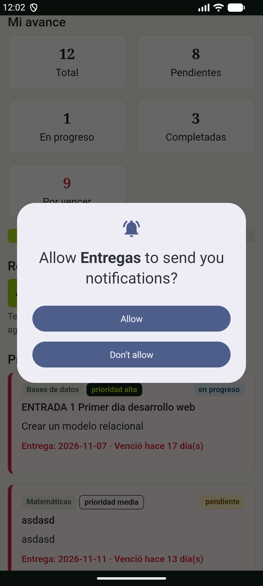 | 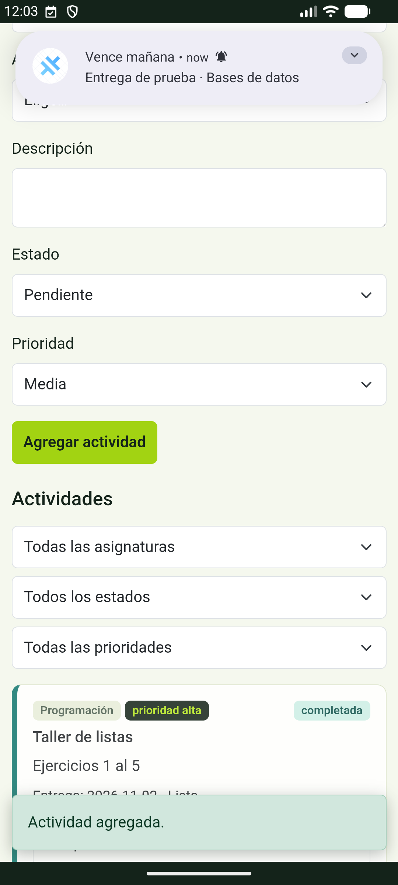 | 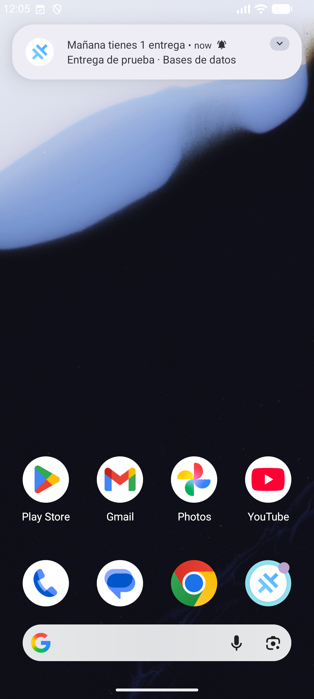 |

La captura con la app cerrada usa un aviso programado a 40 segundos con el mismo plugin y canal; no se esperó a las 9:00 reales, pero sí se comprobó con `dumpsys alarm` que las alarmas quedaron a esa hora.

## 6. Pruebas

Hechas en el emulador Medium Phone API 37 contra la API real. Los toques y el texto se enviaron con `adb`; las fechas y los selectores se rellenaron desde las DevTools del WebView.

| Prueba | Resultado |
|---|---|
| P1 Web | Correcta en escritorio y móvil |
| P2 Build | `dist/` generado sin errores |
| P3 Android | La interfaz carga y se adapta |
| P4 API | `GET /health` → 200 `{"estado":"ok"}`; listados con 200 |
| P5 Escritura | `POST /tareas` → 201 desde Android; visible en la web |
| P6 Persistencia | Tras forzar el cierre y reabrir, la actividad sigue |
| P7 Errores | Con la API detenida: mensaje y «Reintentar»; al encenderla, se recupera |
| P8 UX | Teclado sin tapar el formulario, diálogos nativos y botón Atrás correctos |
| Regla de negocio | Completar con subtareas pendientes → aviso del backend |
| Aviso instantáneo | Actividad para mañana y evaluación para hoy → notificación en el momento |
| Recordatorios programados | 2 → 4 alarmas al agregar; vuelven a 2 al completar o eliminar |
| Toque en la notificación | Abre el Calendario, con la app abierta o cerrada |
| Backend | `pytest`: 12 pruebas aprobadas |

Los registros de prueba se eliminaron; sus movimientos quedan en el Historial.

| Panel | Formulario y teclado | Tras reabrir (P6) |
|---|---|---|
| 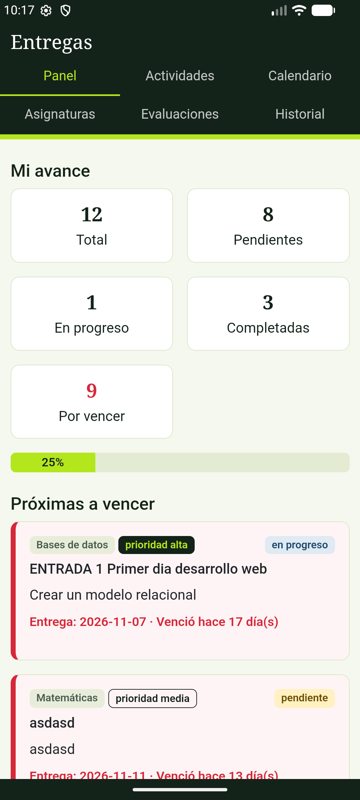 | 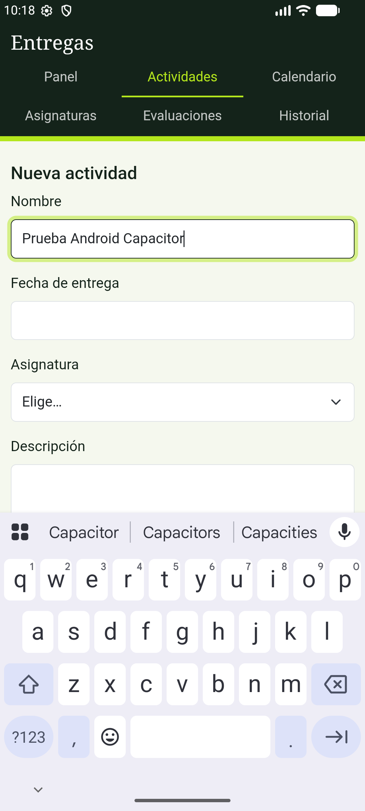 | 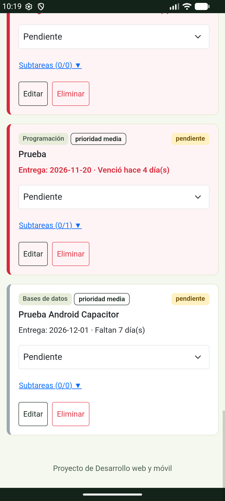 |

| Regla de negocio | API apagada (P7) | Calendario |
|---|---|---|
| 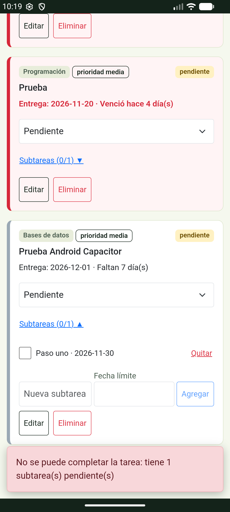 | 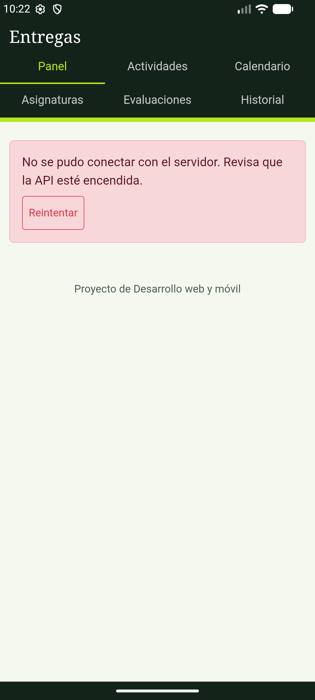 | 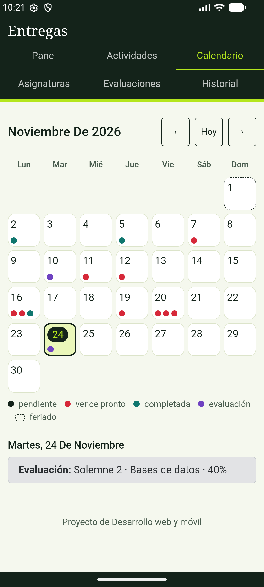 |

La actividad creada en Android, vista en la web:

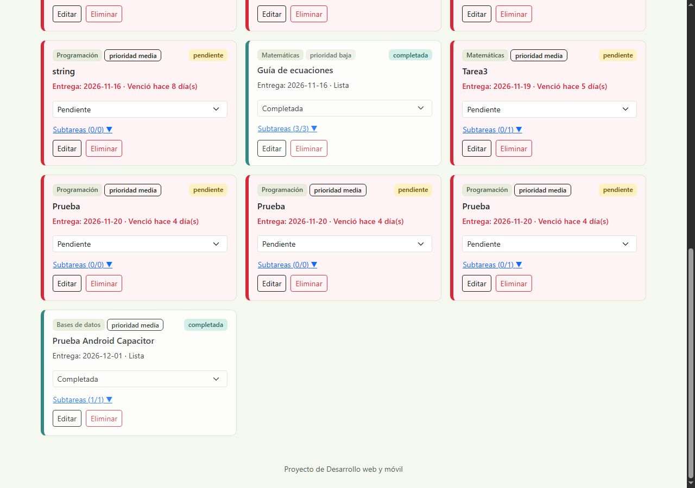

**No se probó** en un teléfono físico ni en versiones de Android anteriores.

## 7. Problemas encontrados

**1. La app abría, pero no conectaba con la API.**
- *Síntoma:* «No se pudo conectar con el servidor», aunque la API estaba encendida y CORS bien configurado.
- *Causa:* Logcat mostró `Mixed Content`. Capacitor sirve la app desde `https://localhost` y el WebView bloquea las peticiones a `http://10.0.2.2:8000`. Ocurre antes que CORS o cleartext.
- *Solución:* `"androidScheme": "http"` en `capacitor.config.json`, más cleartext en debug. Ambos se retiran al publicar con HTTPS.

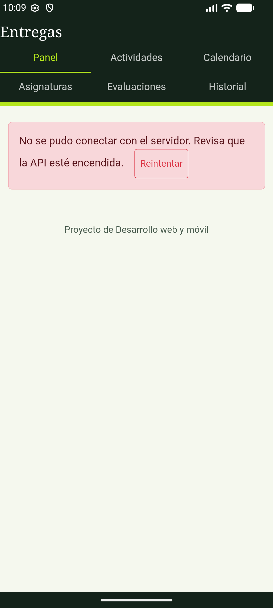

**2. Gradle falló con `AAPT2 Daemon startup failed`.**
- *Causa probable:* falta de memoria; se compilaba a la vez que Docker reconstruía imágenes (1,7 GB libres). `aapt2` funcionaba por separado.
- *Solución:* repetir sin carga paralela y con `--max-workers=2`.

**3. Apareció una barra de título encima de la app.**
- *Causa:* `EdgeToEdge.enable()` se llamaba antes de `super.onCreate()` y la ventana tomaba el tema del splash.
- *Solución:* llamarlo después.

**4. Versión de Java.** Android Studio trae Java 25 y `JAVA_HOME` apuntaba a Java 8; Gradle 8.14.3 no admite 25. Se fijó Java 21 en `android/gradle/gradle-daemon-jvm.properties`.

**5. El plugin de notificaciones abría los Ajustes de Android.**
- *Causa:* desde la versión 8.3, si no se indica lo contrario, pide el permiso de alarmas exactas. Se detectó leyendo su documentación antes de programar.
- *Solución:* `isExactNotification: false` y quitar `SCHEDULE_EXACT_ALARM` del manifiesto.

## 8. Reflexión técnica

**¿Qué se conservó y qué se adaptó?** Se conservaron páginas, rutas, estados, `agendaApi.js`, las reglas del backend y las bases de datos. Se adaptaron los estilos, las etiquetas de formularios, la elección de la URL y CORS.

**¿Por qué el emulador no usa `localhost` como el navegador del PC?** Porque el emulador es otro equipo con su propia red: su `localhost` es el propio Android. `10.0.2.2` es el alias hacia el computador anfitrión.

**¿Qué pasa si la API no está disponible?** La interfaz abre igual, porque viaja dentro del APK, pero no hay datos. Se muestra un mensaje con «Reintentar»; no hay modo sin conexión.

**¿Diferencia entre web responsiva y empaquetar con Capacitor?** La responsiva solo ajusta el diseño y sigue viviendo en un servidor web. Capacitor incluye la compilación en una app instalable, con otro origen, acceso nativo y las reglas de Android (permisos, tráfico, botón Atrás).

**¿Qué falta para publicar?** API con HTTPS y dominio, volver a `androidScheme` https, autenticación real (hoy hay un usuario demo), ícono y splash propios, firma, versión y política de privacidad.
